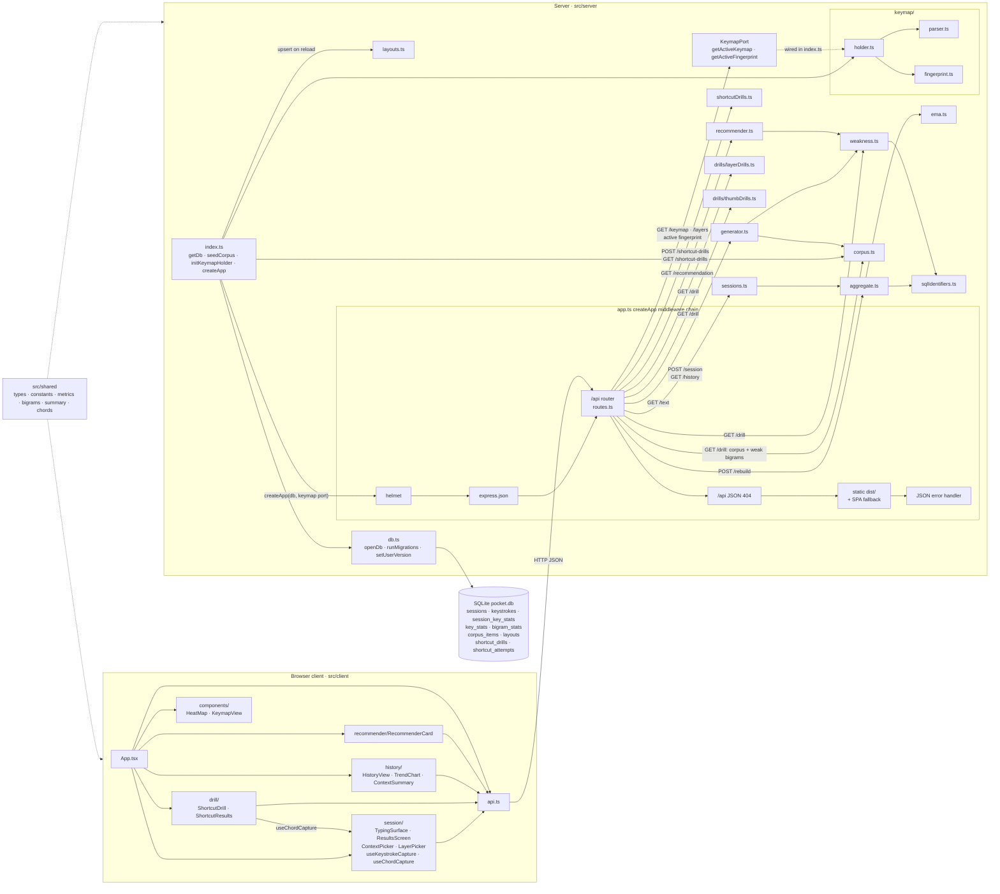
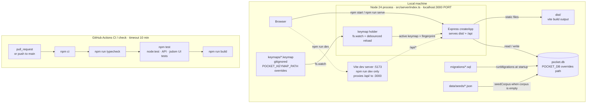
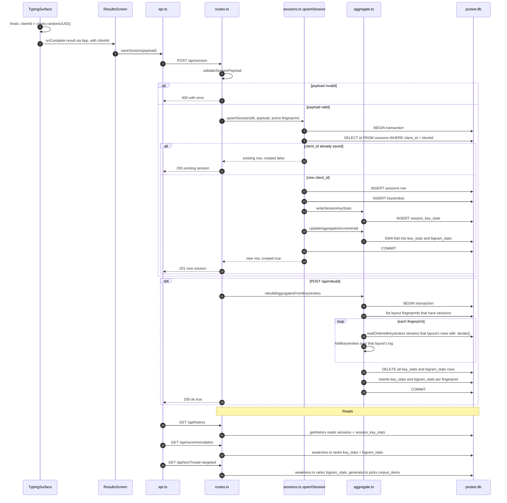
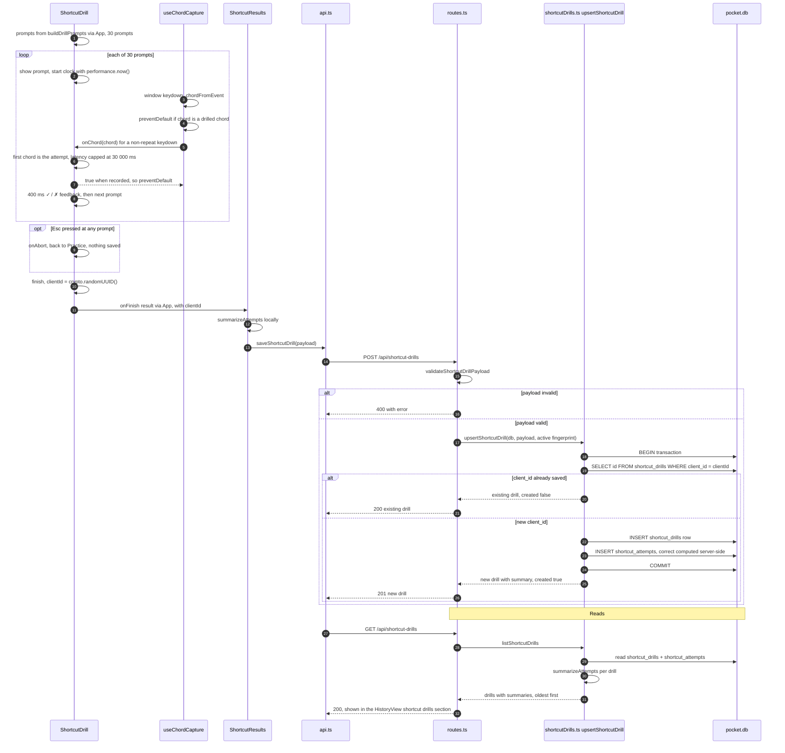

# Pocket architecture diagrams

Four Mermaid views of Pocket as it is on `main`: its components, how it runs and is checked, how a practice session is saved and turned into stats, and how a shortcut drill is captured and saved.

## Components

The browser client is a React SPA whose only link to the server is `src/client/api.ts`, which talks HTTP JSON to `/api`. On the server, `src/server/index.ts` opens the database, seeds the corpus when it is empty, starts the keymap holder and hands both to `createApp`, which wires a fixed middleware chain ending in the `/api` router (`src/server/routes.ts`). `src/shared` holds the types, constants and metric code that both sides import, so the live UI and the save path compute the same numbers. All persistent state is one SQLite file, `pocket.db`, opened and migrated by `src/server/db.ts`. Shortcut drills have their own server module (`src/server/shortcutDrills.ts`, behind `/api/shortcut-drills` in `routes.ts`) and their own tables, and share the chord model in `src/shared/chords.ts` with the client.

## Runtime and checks

Pocket runs as one local Node 24 process on `localhost:3000` (`PORT`) that serves the built `dist/` bundle and the `/api` routes, reads and writes `pocket.db` (path overridable with `POCKET_DB`), applies `migrations/*.sql` and seeds from `data/seeds/` at startup, and watches `keymaps/` (or `POCKET_KEYMAP_PATH`) with debounced reloads. In development, Vite serves the client on `:5173` and proxies `/api/` to the same Express server on `:3000`. The only automation is the GitHub Actions `CI / check` job, which runs on every pull request and every push to `main`. There is no deploy, no cloud service and no secret anywhere in this picture.

## Session save and stats

When a run ends, `TypingSurface` stamps the result with a fresh `clientId` and `ResultsScreen` posts it once; `upsertSession` writes the session, its keystrokes, its per-key stats and the EMA fold in a single transaction, and a replay with the same `clientId` returns the stored row instead of inserting a second one. `POST /api/rebuild` recomputes the EMA cache from the keystroke log for every layout fingerprint that has sessions, folding each layout only from its own keystrokes (joined through `sessions.layout_fingerprint` and streamed with `.iterate()`), and drops `key_stats` and `bigram_stats` rows for layouts with no keystrokes left. Reads never replay keystrokes: history comes from `sessions` and `session_key_stats`, and the recommendation and targeted text come from the weakness ranking over `key_stats` and `bigram_stats`. Shortcut drills never write `sessions`, `keystrokes`, `session_key_stats`, `key_stats` or `bigram_stats`, so rebuild, history and the weakness ranking never see them; the no-drift test in `test/aggregate.test.ts` checks this.

## Shortcut drill capture and save

`App.tsx` builds the prompts with `buildDrillPrompts` (each of the ten `DRILL_CHORDS` `SHORTCUT_DRILL_REPS` = 3 times, shuffled, never the same chord twice in a row) and mounts `ShortcutDrill`, which listens through `useChordCapture`. The first chord pressed for a prompt is its one attempt; auto-repeats and keydowns during the 400 ms ✓/✗ feedback are ignored. Esc aborts and nothing is saved. After the last prompt, `ShortcutDrill` stamps the result with a fresh `clientId`, and `ShortcutResults` summarises it locally with `summarizeAttempts` (so the table renders even if the save fails) and posts it once. `upsertShortcutDrill` writes the drill and its attempts in one transaction, computing `correct` itself, and a replay with the same `clientId` returns the stored drill instead of inserting a second one. Nothing on this path touches the typing tables.

